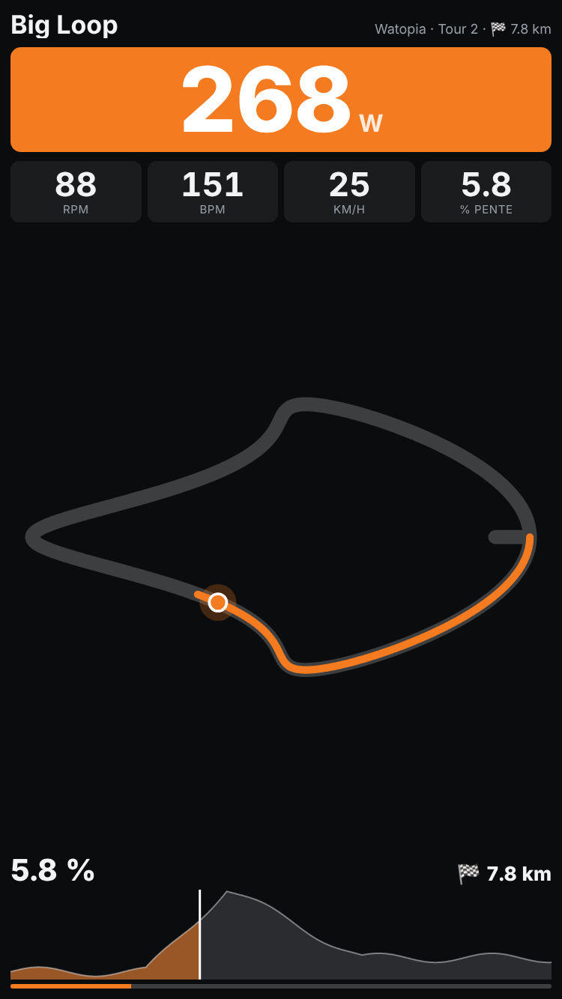
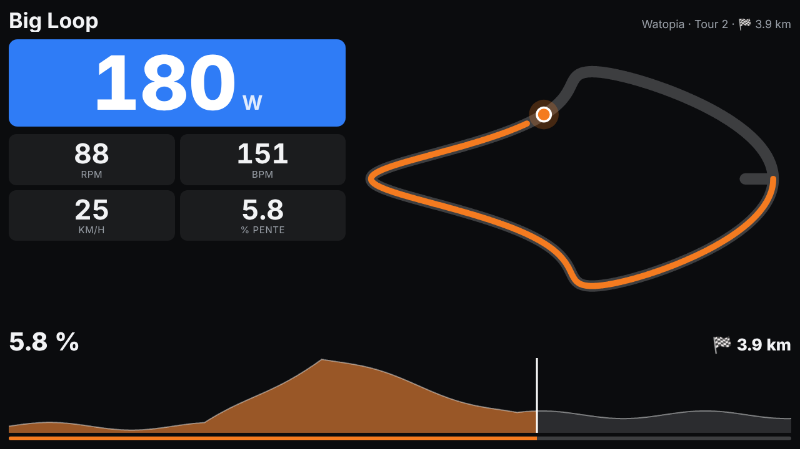

# Zwift Map pour Home Assistant

Affiche la **route Zwift que tu roules**, en direct, sur un écran Home Assistant visible depuis le vélo : carte du parcours avec ta position, profil d'altitude, pente, distance restante et puissance sur la couleur de ta zone. Pensé pour un écran mural (NSPanel Pro 120, tablette…) face au home trainer.

<p align="center">
  
  
</p>

<sub>Style « simple », avec un parcours simulé. Par défaut, le style « zwift » affiche la carte illustrée du monde avec la route, les segments et ta position.</sub>

## Ce que ça fait

- **Intégration `zwift_map`** : interroge Zwift toutes les 2 s pendant que tu roules (toutes les 30 s sinon) et lit les champs que les autres intégrations ignorent, en particulier l'**identifiant de la route** et le **monde**.
- **Progression réelle sur la route** : la distance de Zwift est celle de toute la sortie. L'intégration repart de zéro quand une route est choisie, déduit le **lead-in** (différent en événement et en free ride) et compte les **tours**. Exemple : 10 km de free ride puis 1 km sur une route de 20 km donnent **5 %**, pas 55 %.
- **Carte façon Zwift** : la carte illustrée du monde avec la route, le lead-in, les segments chronométrés (KOM, sprints) et le profil complet, dès la première sortie. Ces cartes viennent de [ZwiftHacks](https://zwifthacks.com). L'intégration télécharge celle d'une route la première fois qu'elle s'affiche, puis la garde dans `/config/zwift_map/zwifthacks/` : une image de fond par monde, plus un petit fichier par route. Ta position est placée selon la distance parcourue sur le tracé.
- **Tracé enregistré pendant tes sorties** (solution de repli) : à chaque passage, la position et l'altitude envoyées par le jeu sont enregistrées tous les 10 m dans `/config/zwift_map/tracks/<route_id>.json`. C'est ce tracé que la carte utilise quand ZwiftHacks ne connaît pas la route ou n'est pas joignable.
- **Carte Lovelace `zwift-map-card`** : servie directement par l'intégration, rien d'autre à installer.

## Installation

1. HACS → ⋮ → *Dépôts personnalisés* → `https://github.com/Lobwick/zwift-map-home-assistant`, catégorie **Intégration**.
2. Installe **Zwift Map** et redémarre Home Assistant.
3. *Paramètres → Appareils et services → Ajouter une intégration → Zwift Map*, puis saisis ton compte Zwift.

### Entités

| Entité | Contenu |
|---|---|
| `binary_sensor.zwift_map_riding` | Tu es sur Zwift |
| `sensor.zwift_map_route` | Nom de la route (attributs : distance, dénivelé, lead-in, couverture du tracé) |
| `sensor.zwift_map_world` | Monde (Watopia, France…) |
| `sensor.zwift_map_route_progress` | Progression sur la route (%) |
| `sensor.zwift_map_route_distance` | Distance parcourue sur la route (km) |
| `sensor.zwift_map_remaining_distance` | Distance restante (km) |
| `sensor.zwift_map_lap` | Tour en cours |
| `sensor.zwift_map_gradient` | Pente (%) |
| `sensor.zwift_map_live` | Phase (`free_ride`, `lead_in`, `on_route`…) avec toutes les données en direct en attributs, non enregistrées dans l'historique. C'est la source de la carte. |

## La carte

```yaml
type: custom:zwift-map-card
entity: sensor.zwift_map_live
# Couleur de zone : reprend celle de l'intégration Zwift si elle est installée…
zone_color_entity: light.zwift_<prénom>_power_zone_color
# …ou la calcule à partir de ta FTP
ftp_entity: sensor.zwift_<prénom>_ftp   # ou ftp: 252
layout: auto          # auto | portrait | landscape
map_style: zwift      # zwift (carte ZwiftHacks) | simple (tracé enregistré seulement)
map_view: route       # route (toute la route) | follow (zoom qui suit le cycliste)
follow_m: 2500        # largeur de la carte en vue follow, en mètres
map_rotate: 0         # style simple : 0 | 90 | 180 | 270
map_mirror: false     # style simple
show_map: true
show_profile: true
show_stats: true
```

Sur un écran dédié, mets la carte seule dans une vue en mode **Panneau** : elle occupe tout l'écran, et la carte du parcours prend l'espace libre. Le format portrait est prévu pour les 750×1334 du NSPanel Pro 120.

## Limites

- **API non officielle** : c'est celle qu'utilise Zwift Companion. Zwift peut la modifier sans prévenir.
- **Requêtes limitées** : si une autre intégration Zwift interroge aussi le serveur toutes les 2 s, Zwift peut répondre « trop de requêtes » (429). Zwift Map ralentit alors automatiquement, puis revient à 2 s.
- **À valider en conditions réelles** : le champ « route » (n° 39) est documenté par la communauté. Son comportement en événement (group ride, course) reste à confirmer.
- **Cartes ZwiftHacks** : elles servent à ton usage personnel, ne sont pas incluses dans le dépôt, et l'intégration ne les télécharge qu'une fois par route. Si ZwiftHacks change son format ou ne connaît pas une route, la carte passe sur le tracé enregistré.
- **Free ride sans route** : pas de route, donc pas de carte de parcours. Les compteurs et la pente restent affichés.
- **Redémarrage de Home Assistant en pleine sortie** : la progression reprend là où elle en était, mais seulement sur la même route.

## Crédits

- Catalogue des routes (noms, distances, dénivelés, lead-in) : [zwift-data](https://github.com/andipaetzold/zwift-data) © Andi Pätzold, licence MIT. Pour le régénérer : `scripts/build_routes.mjs`.
- Cartes, tracés des routes, segments et profils : [ZwiftHacks](https://zwifthacks.com), téléchargés à l'usage et non redistribués. Les fonds de carte sont dérivés de ceux du jeu Zwift.
- Description des champs du protocole Zwift : travail de rétro-ingénierie de la communauté, notamment le projet [zwift-offline](https://github.com/zoffline/zwift-offline).
- Projet non affilié à Zwift. « Zwift » est une marque de Zwift, Inc.

## Développement

```bash
pip install pytest-homeassistant-custom-component
pytest            # tests/ : logique pure ; tests/ha : intégration chargée dans Home Assistant
```
